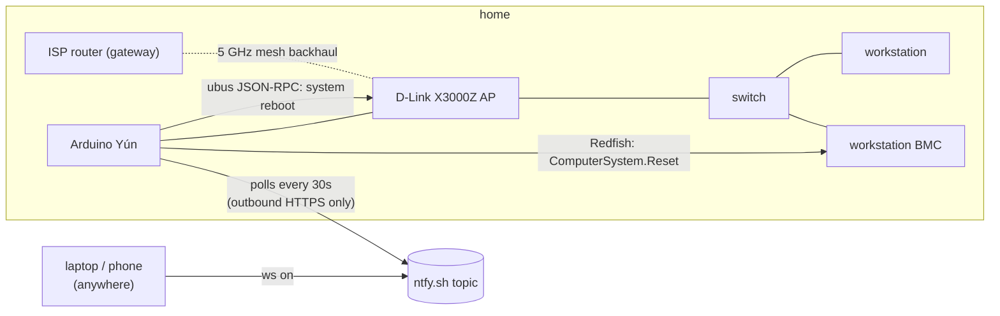

# homelab-oob

Out-of-band control for a GPU workstation at home that I usually manage from somewhere else. It does two jobs:

1. Keep the network up. The access point the workstation hangs off sometimes loses its wireless backhaul and stays down until someone reboots it. A watchdog notices and reboots it through the AP's own web API.
2. Keep the workstation off when idle. The box idles at about 95 W. It now stays powered off, and I power it on remotely through its BMC when I need it, from anywhere, with no VPN or open ports at home.

Both run on an Arduino Yún from 2013: 400 MHz MIPS, 64 MB RAM, OpenWrt with a 2016 kernel.

## Layout

| Path | What it is |
|---|---|
| `yun/x3000z-watchdog.py` | Router watchdog, Python 2.7 (all the Yún has). Started by `yun/init.d/x3000z-watchdog`. |
| `yun/ws-remote.py` | Polls ntfy for `status`/`on`/`off`/`forceoff`, calls the BMC's Redfish API, replies on a second topic. Started by `yun/init.d/ws-remote`. |
| `laptop/ws.fish` | The client: `ws on` sends the command, waits for the reply, then waits until the workstation answers over Tailscale. |
| `workstation/` | The original Python 3 watchdog plus its systemd unit. Still runs as a second watchdog whenever the workstation is on. |
| `config/*.example` | Placeholder config. The real files are root-only and not in this repo. |

## How it works

### The watchdog

The AP has no cable to the ISP router, only a wireless mesh link. When that link drops, everything wired into the AP still works locally but nothing gets out. So the watchdog pings the ISP router instead of the internet. If the ISP itself is down, the router still answers and the AP is left alone. After five failed checks a minute apart it reboots the AP, then waits at least 15 minutes before it will try again.

The AP has no documented API. Its web UI talks JSON-RPC to OpenWrt's `ubus` at `/ubus`, and the login is in the UI's JavaScript:

1. `routerd get_rand_key` returns 64 hex characters. The first 32 are a key index, the next 32 are an AES-128 key.
2. The password is sent as `key_index + hex(AES-128-CBC(password))`, with a fixed IV hardcoded in the JS.
3. `routerd login` returns a session token, and `system reboot` with that token reboots the AP.

The Yún's Python has no crypto library and its package feed is dead, so the encryption shells out to `openssl enc`. `tests/` checks that output against pycryptodome.

### Remote power-on

The Yún can't run Tailscale: the kernel has no TUN device and there's about 10 MB of RAM free. Rather than open a port at home, it polls a private [ntfy](https://ntfy.sh) topic over outbound HTTPS and answers on a second one. The two random topic names are the shared secret. The poller remembers message IDs so a command never runs twice, and on startup it only looks back one poll interval so old commands aren't replayed.

The Yún's OpenSSL (1.0.1, from 2014) can't talk to the BMC at all, because the BMC only accepts TLS 1.2 ECDHE-GCM or TLS 1.3. It can't talk to ntfy.sh either. Both calls go through a static, checksum-verified [curl build](https://github.com/stunnel/static-curl) with a current CA bundle, kept on the SD card.

The BMC account the Yún uses has Operator privilege only: it can switch power but can't change users or BMC settings. The BMC's power-restore policy is `previous`, so after a blackout the workstation comes back in whatever state it was in.

## Things that went wrong

- The drops were probably caused by DFS. The ISP router's 5 GHz channel was on Auto, which can land on DFS channels that must move off when radar is detected. The mesh backhaul didn't always follow. If that's right, pinning the channel to a non-DFS one fixes it, and the watchdog covers anything else.
- Infinite DHCP leases break an old netifd. After I reserved the Yún's IP on the router, the router handed out a lease of 268435455 seconds. Forcing a renew (`kill -USR1` udhcpc) then dropped the Yún's default route: the LAN still worked, the internet didn't. A fresh DHCP request (`ifup wan`, or any reboot) installs the route fine. An infinite lease never renews by itself, so this only happens if you force it.
- A graceful shutdown from the BMC doesn't shut the box down. GNOME grabs the ACPI power button and shows a dialog. While the box is on it's reachable anyway, so `systemctl poweroff` over SSH is the clean way off. The Yún mostly exists for `on`.
- The Yún's SSH server is dropbear 2011.54. It only speaks `diffie-hellman-group14-sha1` and `ssh-rsa`, so it needs its own RSA key and those algorithms re-enabled on the client side.
- The workstation's OS lives on a 7200 rpm HDD. From `ws on` to reachable over Tailscale takes about 2:45: POST 1:12, bootloader 0:41 (GRUB reading an 83 MB initrd off the disk), kernel 0:13, then userspace. The fully booted desktop is about a minute after that.

## Verified

- Watchdog: on both the workstation and the Yún, `--test` logs in and `--reboot-now` really rebooted the AP (in the workstation run, the wired links dropped four seconds after the call). The Yún copy autostarts after a reboot, and a cron job restarts it if it dies. The automatic path (five failed pings, then reboot) hasn't caught a real backhaul drop yet.
- Remote power: full cycle `ws status` → `systemctl poweroff` → `ws status` (Off) → `ws on` → workstation boots, auto-logs in, and Sunshine is running in that session.
- `tests/`: `uv run --no-project --with pytest --with pycryptodome pytest -q tests`

## Security notes

- Credentials live in root-only files on each device (`/etc/x3000z-watchdog.env`, `/etc/bmc.netrc`) and never appear on a command line.
- The Yún's factory open Wi-Fi AP, web panel, web terminal, AllJoyn and avahi are all disabled. Only SSH is listening.
- Anyone who learns the ntfy topic names can switch the workstation on or off. That's the accepted trade-off for having no inbound ports. The topic names are not in this repo.

The IP addresses in the code are the ones on my home network. Change them to match yours.

Built with [Claude Code](https://claude.com/claude-code) as a pair programmer.
