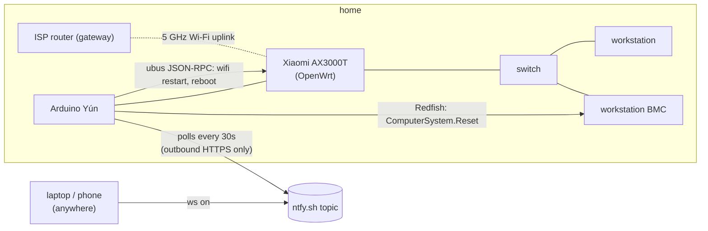

# homelab-oob

Out-of-band control for a GPU workstation at home that I usually manage from somewhere else. It does two jobs:

1. Keep the network up. The room's router reaches the ISP router over a single Wi-Fi link. When that link drops, a watchdog restarts the router's uplink, and reboots the router if that doesn't help.
2. Keep the workstation off when idle. The box idles at about 95 W. It now stays powered off, and I power it on remotely through its BMC when I need it, from anywhere, with no VPN or open ports at home.

Both run on an Arduino Yún from 2013: 400 MHz MIPS, 64 MB RAM, OpenWrt with a 2016 kernel.

## Layout

| Path | What it is |
|---|---|
| `yun/room-watchdog.py` | Uplink watchdog, Python 2.7 (all the Yún has). Started by `yun/init.d/room-watchdog`. |
| `yun/ws-remote.py` | Polls ntfy for `status`/`on`/`off`/`forceoff`/`report`, calls the BMC's Redfish API, replies on a second topic, and publishes a status snapshot to a third. Started by `yun/init.d/ws-remote`. |
| `laptop/ws.fish` | The client: `ws on` sends the command, waits for the reply, then waits until the workstation answers over Tailscale. |
| `workstation/ws-status-push.*` | Publishes the workstation's own snapshot (GPU, disk, services, desktop session) at boot and every 30 minutes. |
| `dashboard/` | `homelab`, a Textual TUI on the laptop that shows the latest snapshots. |
| `config/*.example` | Placeholder config. The real files are root-only and not in this repo. |

## How it works

### The watchdog

The room's router has no cable to the ISP router, only a Wi-Fi client link. When that link drops, everything wired into the router still works locally but nothing gets out. So the watchdog pings the ISP router instead of the internet. If the ISP itself is down, the ISP router still answers and the room is left alone.

After five failed checks a minute apart, the watchdog restarts the router's uplink radio, which brings a healthy link back in about 15 seconds. If the link is still down 10 minutes later, it reboots the router (about 3.5 minutes until the uplink is back) and keeps doing that every 10 minutes while it stays down. When the link comes back, it posts a notice to ntfy saying how long the outage lasted and what fixed it. Every fifth check it pings healthchecks.io, which alerts me if the room goes quiet. It also logs ping loss and RTT every minute, and the uplink signal every ten, to CSV files on the SD card.

A failed ping can also mean the Yún has lost its own default route (see the DHCP lease entry under "Things that went wrong"). Before it counts a failure against the router, the watchdog checks `/proc/net/route`, and if the default route is missing it runs `ifup wan` on itself and leaves the router alone.

The Yún talks to the router through OpenWrt's `ubus` JSON-RPC endpoint at `/ubus`, logged in as a dedicated `yun` user. Its ACL allows exactly three things: read the uplink's status (`iwinfo info`), run `/sbin/wifi`, and `system reboot`. The Yún opens each session with a 60-second timeout, so the account doesn't need permission to log out.

If the Yún itself dies, the router covers for it: `watchcat` on the router reboots it after 30 minutes without an answer from the ISP router.

### The previous access point

Until October 2026 the room hung off a D-Link DIR-X3000Z joined to the ISP router by a 5 GHz mesh backhaul. That link dropped at random and only a reboot brought it back. The X3000Z has no documented API, but its web UI talks to `ubus` too, with the login in the UI's JavaScript: `routerd get_rand_key` returns a key index and an AES-128 key, the password goes up as `key_index + hex(AES-128-CBC(password))` with a fixed IV, and `routerd login` returns a session for `system reboot`. The Yún did the AES through `openssl enc`, since its Python has no crypto library. That version of the watchdog is in the git history (`f010b18`).

The reboot worked when I tested it by hand, but never in a real drop. The X3000Z's management IP came from DHCP over the very link that had failed, so during an outage it simply wasn't there: in one 58-hour outage the Yún made 226 attempts and every one failed with `No route to host`. That's why the X3000Z was replaced by an OpenWrt router whose LAN address is static and stays reachable when its uplink is down.

### The router

The router is a Xiaomi AX3000T (MT7981, 128 MB NAND). I unlocked it through a known exploit in the stock firmware and flashed OpenWrt 25.12. The room is its own routed subnet behind the router's NAT instead of a bridge onto the house LAN. The router is also a Tailscale subnet router for that subnet, so the BMC and the Yún are reachable from my tailnet without running Tailscale themselves.

The ISP router hands out one IPv6 `/64` and doesn't delegate prefixes, so the room gets IPv6 through OpenWrt's relay mode: the router passes the house `/64` through and proxies neighbour discovery for the room's addresses. Traffic is still routed, so the firewall's wan-to-lan reject covers IPv6 as well. From the house side, every TCP port on the workstation's IPv6 address gets a reset from the router. The point of it is Tailscale: with IPv6 it can often connect directly where IPv4 is stuck behind two layers of NAT.

It also fixed the room's latency under load. I measured it with the Waveform bufferbloat test from a wired laptop in the room:

| | Speed (Mbit/s, down / up) | Added latency, download | Added latency, upload |
|---|---|---|---|
| Old X3000Z | 551 / 123 | +40 ms | +103 ms |
| AX3000T, no SQM | 504 / 102 | +94 ms | +1 ms |
| AX3000T, cake at 450 Mbit | 421 / 202 | +19 ms | +2 ms |

Upload needed no shaping: the Linux Wi-Fi stack's own queueing keeps it flat. Download shaping is limited by the router's dual-core A53. With cake, receive processing pinned one core at 99% and packets started dropping in the Wi-Fi driver before cake could see them. Spreading packet steering across both cores fixed that, and the cap sits where both cores run at about 85%.

### Remote power-on

The Yún can't run Tailscale: the kernel has no TUN device and there's about 10 MB of RAM free. Rather than open a port at home, it polls a private [ntfy](https://ntfy.sh) topic over outbound HTTPS and answers on a second one. The poller remembers message IDs so a command never runs twice, and on startup it only looks back one poll interval.

Commands are signed: `on 1761380000 <HMAC-SHA256 of "on 1761380000">`, with a key that sits in the config file on the laptop and on the Yún and nowhere else. The Yún drops anything unsigned, anything more than two minutes off its clock, and any timestamp it has already accepted, so someone who learns the topic name can read the replies but can't send a command or replay one. The Python 2.7.3 on the Yún predates `hmac.compare_digest`, so it compares signatures in constant time by hand. One side effect: for the first two minutes after the Yún boots its clock is wrong, and it refuses every command until NTP fixes it.

The Yún's OpenSSL (1.0.1, from 2014) can't talk to the BMC at all, because the BMC only accepts TLS 1.2 ECDHE-GCM or TLS 1.3. It can't talk to ntfy.sh either. Both calls go through a static, checksum-verified [curl build](https://github.com/stunnel/static-curl) with a current CA bundle, kept on the SD card.

The BMC account the Yún uses has Operator privilege only: it can switch power but can't change users or BMC settings. The BMC's power-restore policy is `previous`, so after a blackout the workstation comes back in whatever state it was in.

### Dashboard

`homelab` shows what would otherwise take a handful of commands: the workstation's power state and whether its OS answers over Tailscale, its GPU, disk and services, the BMC's temperature and fan sensors, the router watchdog's recent log, and the Yún's own health.

Nothing at home serves it. The Yún and the workstation each publish a JSON snapshot to a private ntfy topic every 30 minutes, and the dashboard reads the newest one per device from ntfy's cache, so it opens on the last known state straight away. Pressing `r` sends `report` to the Yún, which publishes a fresh snapshot within one poll cycle (about 30 seconds). When the workstation is off, its last snapshot stays on screen, dimmed and marked as history.

The interval comes from ntfy.sh's free limits: 250 messages a day per IP, and the Yún and workstation share one. Two devices every 30 minutes is about 100 a day. Each snapshot has to fit in one 4,096-byte message, so the Yún sends only the BMC sensors that have a reading (about 900 bytes) instead of the raw 7 to 10 KB Redfish documents.

## Things that went wrong

- The X3000Z's drops weren't DFS. The ISP router's 5 GHz channel was on Auto, which can land on DFS channels that have to move when radar shows up, so I pinned it to channel 149 (non-DFS). The backhaul dropped again four days later and stayed down for 58 hours.
- The Yún's old netifd drops its default route whenever udhcpc renews a lease. The LAN keeps working and the internet doesn't. A fresh DHCP request (`ifup wan`, or any reboot) installs the route fine. Behind the ISP router this only showed up when I forced a renew, because the Yún's reserved IP came with a lease of 268435455 seconds, which never renews by itself. The new router hands out 12-hour leases, so six hours after the cutover the Yún renewed and lost its route. The watchdog took that for an uplink outage and rebooted a healthy router every 10 minutes for nine hours. The Yún's reservation on the router now has an infinite lease, and the watchdog checks its own route before it blames the router.
- A graceful shutdown from the BMC doesn't shut the box down. GNOME grabs the ACPI power button and shows a dialog. While the box is on it's reachable anyway, so `systemctl poweroff` over SSH is the clean way off. The Yún mostly exists for `on`.
- The Yún's SSH server is dropbear 2011.54. It only speaks `diffie-hellman-group14-sha1` and `ssh-rsa`, so it needs its own RSA key and those algorithms re-enabled on the client side. That wasn't quite enough after the Yún's IP changed: with no saved host key for the new address, OpenSSH 10.6 sends its full list of modern algorithms and dropbear drops the connection within 10 ms. A `HostKeyAlias` pointing at the old known_hosts entry makes the client lead with `ssh-rsa` again.
- OpenWrt's `network.wireless` object rejects calls made over the web API. The web API adds a `ubus_rpc_session` field to every call's arguments, and `network.wireless` validates its arguments strictly, so a radio restart over HTTP fails with "invalid argument" even with the right ACL. The watchdog runs `/sbin/wifi` through `file exec` instead, which is what LuCI does.
- My first bufferbloat runs through the new router measured the old one. Only the laptop's IPv4 default route pointed at the new router, and the browser used IPv6 over the laptop's Wi-Fi. The giveaway was the router's CPU sitting at 0% during a 300 Mbit/s test.
- IPv6 relay mode needs `sourcefilter=0` on the upstream interface. Without a delegated prefix, netifd installs the IPv6 default route as `default from <the router's own address>`, so the router itself has IPv6 while every forwarded packet from the room fails with "no route". The relay also takes a few seconds to learn each device's address before return traffic finds its way back.
- The workstation's OS lives on a 7200 rpm HDD. From `ws on` to reachable over Tailscale takes about 2:45: POST 1:12, bootloader 0:41 (GRUB reading an 83 MB initrd off the disk), kernel 0:13, then userspace. The fully booted desktop is about a minute after that.

## Verified

- Watchdog: `--test` logs in as `yun` and reads the uplink, and `--restart-wifi` took the uplink down and had the router back on the ISP router 15 seconds later. The `yun` session's ACL, read back on the router, holds exactly the three calls. The reboot path has fired from the Yún for real, though for the wrong reason (the lease entry above), and the router came back each time. Deleting the Yún's default route by hand got it back through `ifup wan` within 4 seconds. The watchdog autostarts after a reboot, and a cron job restarts it if it dies. The automatic path (five failed pings, then recovery) hasn't caught a real drop yet.
- Remote power: full cycle `ws status` → `systemctl poweroff` → `ws status` (Off) → `ws on` → workstation boots, auto-logs in, and Sunshine is running in that session.
- Dashboard: run headless against the live topics, both devices' snapshots render, and `r` brought a fresh Yún snapshot in 29 seconds.
- `dashboard/tests/`: `cd dashboard && uv run pytest -q`

## Security notes

- Credentials live in root-only files on each device (`/etc/room-watchdog.env`, `/etc/bmc.netrc`) and never appear on a command line.
- The BMC's certificate is self-signed, so curl runs with `-k` plus `--pinnedpubkey`. The pin lives in `/etc/ws-remote.conf` as `BMC_PUBKEY_PIN`, and a BMC presenting any other key is refused (curl exit 90). Get the value with `openssl s_client -connect <bmc>:443 </dev/null | openssl x509 -pubkey -noout | openssl pkey -pubin -outform der | openssl dgst -sha256 -binary | base64`, ideally from two machines, and check they agree.
- The router login goes over plain HTTP on the room LAN. The `yun` account's password is random and used nowhere else, and its ACL limits it to reading the uplink, restarting Wi-Fi and rebooting. Only a hash is stored on the router.
- On the Yún, the factory open Wi-Fi AP, web panel, web terminal, AllJoyn, avahi and dnsmasq are all disabled. SSH is key-only, and it's the only port listening.
- IPMI over LAN is off on the BMC (`ipmitool lan set 1 access off`, run in-band from the workstation). IPMI 2.0 hands a crackable password hash to anyone who asks, and nothing here needs it. Redfish and the web UI are unaffected. I checked with an unauthenticated "Get Channel Authentication Capabilities" probe: it gets an answer with access on and silence with it off.
- The BMC's SSH, serial-over-SSH and VNC services are off too, which leaves 443 (web UI, the browser KVM console, Redfish) and an internal TCP 623 with no switch. The remote console runs in the browser over 443, so VNC wasn't needed.
- On the tailnet, only my own login can use the room subnet route or SSH into the workstation. Other members reach only their own devices, and GPU tenants only the workstation's HTTPS. The policy file has tests that Tailscale runs on every save, asserting both that I can reach the BMC and the Yún and that another member can't.
- Anyone who learns the ntfy topic names can read the replies and status snapshots, which is the accepted trade-off for having no inbound ports. They can't send commands, which need the HMAC key (see "Remote power-on"). Neither the topic names nor the key are in this repo.
